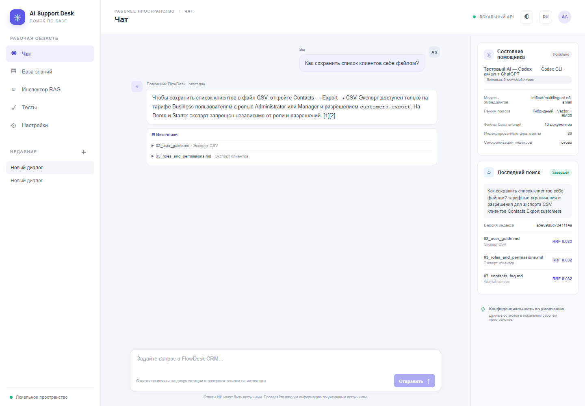
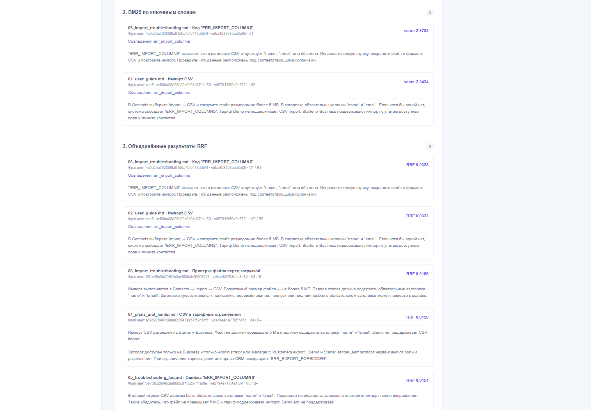
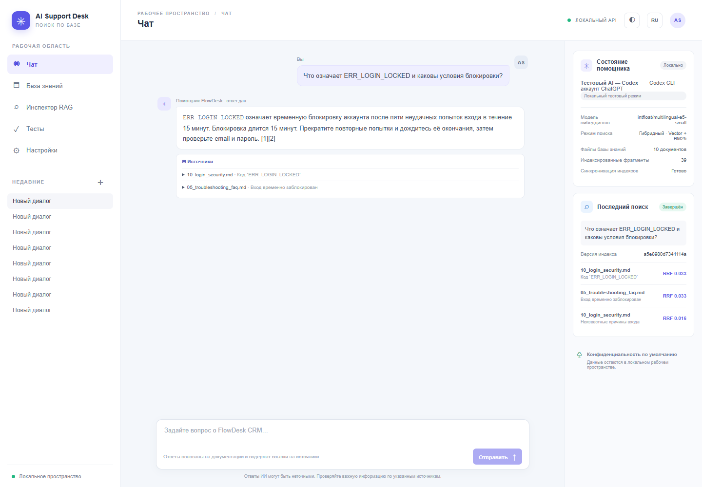
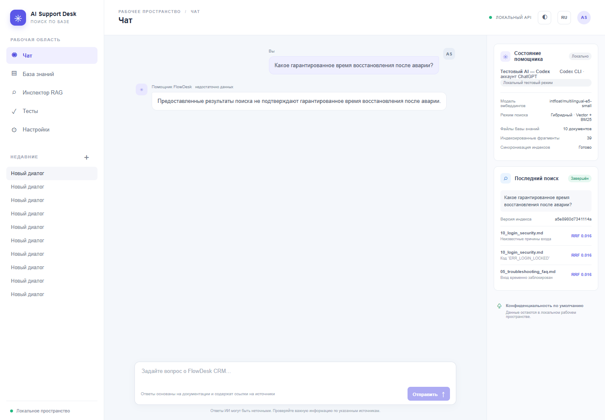
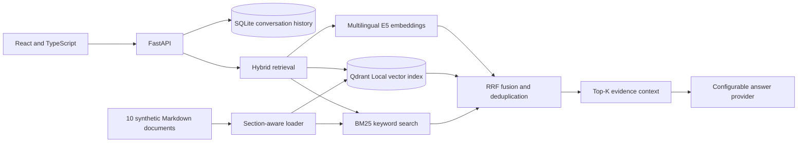
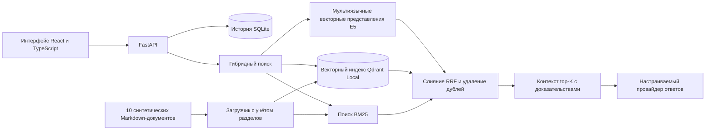

# AI Support Desk — Hybrid RAG Support Assistant

**Release status:** This repository contains the Showcase package that passed local privacy review. The Live Demo is not deployed; production security gates remain open.
**Sample content:** fictional FlowDesk CRM documentation only.

## Product

AI Support Desk is a local-first support assistant that answers questions from a versioned knowledge base and cites the evidence used. The Pro retrieval pipeline combines multilingual E5 embeddings, Qdrant Local vector search, BM25 keyword search, Reciprocal Rank Fusion (RRF), and configurable top-K context. Its inspector exposes the vector branch, BM25 branch, fused ranking, and exact context supplied to the answer provider.

## Pro capabilities

- 10 synthetic Russian knowledge documents and 39 indexed chunks.
- `intfloat/multilingual-e5-small` embeddings with 384 dimensions.
- Hybrid vector and BM25 retrieval, RRF fusion, and chunk deduplication.
- Source citations and evidence-based refusal when the corpus does not support an answer.
- Request diagnostics for both search branches, fused results, index revision, and final LLM context.
- React/TypeScript interface, FastAPI backend, Qdrant Local index, and SQLite conversation history.

## Verified results

The final isolated desktop browser run passed 10/10 answer scenarios and 10/10 strict source-section and citation checks. It covered role questions, paraphrased CSV export, exact and mixed error codes, plan and permission conditions, English-to-Russian retrieval, and an unknown recovery-time question. P02 and P08 passed after their retrieval and grounding corrections. Backend regression checks passed 21/21. The login UI scenario, local-provider prompt-injection retest, and 390px mobile viewport also passed (4/4 Playwright tests total).

The run used the local CodexTestProvider. DeepSeek live generation, production credentials, public deployment, and production readiness have not been verified. A separate retrieval-only evaluation passed 10/10 cases and 20/20 language variants; it measures retrieval, not generated-answer quality. The local prompt-injection retest passed against CodexTestProvider; it does not verify DeepSeek or production behavior.

## Evidence screenshots

All images use synthetic FlowDesk questions and data. The P02 example demonstrates a paraphrased export question with citations; P03 shows the RRF diagnostic; P08 shows a grounded login-lockout answer; P10 shows refusal when the source corpus has no recovery-time guarantee.

## High-level architecture

## Showcase files

The public package should contain only this reviewed description, a high-level architecture diagram, selected synthetic screenshots, verified metrics, and limitations. Do not include application source, internal prompts or instructions, databases, vector indexes, runtime logs, session identifiers, credentials, or machine-specific paths.

## Live Demo readiness

The local prototype is not ready for direct internet exposure. A public demo requires real authentication, server-issued sessions and data isolation, protected or disabled administration, abuse limits, HTTPS, deployment-specific secret storage, safe logging and retention, monitoring, backup and recovery, and a security review. Only a separate synthetic dataset may be used. Deployment remains pending closure of that checklist and the owner's explicit release approval.

## Privacy and release checklist

- [x] Review every file and screenshot included in the Showcase package.
- [x] Confirm public package contains no secrets, private prompts, local paths, user/session data, or runtime data.
- [x] Verify each public claim against the final evidence and label the local test provider accurately.
- [x] Review the private source repository's exact initial commit file list and secret scan.
- [ ] Complete the deployment security checklist before opening a Live Demo.
- [ ] Obtain separate owner approval before deploying a Live Demo.

---

# AI Support Desk — помощник поддержки на Hybrid RAG

**Статус выпуска:** этот репозиторий содержит пакет Showcase, прошедший локальную проверку конфиденциальности. Live Demo не развёрнута; требования безопасности production-среды остаются открытыми.
**Данные примера:** только вымышленная документация FlowDesk CRM.

## Продукт

AI Support Desk отвечает на вопросы по версионируемой базе знаний и указывает подтверждающие источники. В Pro используются мультиязычные векторные представления E5, векторный поиск Qdrant Local, поиск BM25 по ключевым словам, объединение Reciprocal Rank Fusion (RRF) и настраиваемый контекст top-K. Инспектор показывает обе поисковые ветки, объединённое ранжирование и точный контекст, переданный провайдеру ответа.

## Скриншоты с тестовыми данными

Все снимки показывают синтетические вопросы FlowDesk. P02 демонстрирует перефразированный вопрос об экспорте с цитатами; P03 — диагностику RRF; P08 — ответ с подтверждёнными условиями блокировки; P10 — отказ на неподтверждённую гарантию срока восстановления.

## Возможности Pro

- 10 синтетических русскоязычных документов и 39 индексированных фрагментов.
- Модель `intfloat/multilingual-e5-small`, размерность векторов — 384.
- Гибридный векторный поиск и BM25, слияние RRF и удаление повторов.
- Цитаты источников и отказ при недостаточности подтверждений в базе.
- Диагностика обеих поисковых веток, итогового ранжирования, версии индекса и контекста для LLM.
- Интерфейс React/TypeScript, backend FastAPI, индекс Qdrant Local и история диалогов SQLite.

## Подтверждённые результаты

Итоговая изолированная браузерная проверка на компьютере прошла 10 из 10 сценариев ответов и 10 из 10 строгих проверок источников, разделов и цитат. Проверены вопросы о ролях, перефразированный запрос экспорта CSV, точные и смешанные коды ошибок, условия тарифов и прав, запрос на английском к русской базе и вопрос о неизвестном сроке восстановления. После исправлений P02 и P08 прошли проверки извлечения, ответа и цитат. Регрессионные проверки backend: 21 из 21 пройдены. Отдельно прошли UI-сценарий входа (API подменён), adversarial prompt injection на локальном CodexTestProvider и мобильная проверка 390 px; общий дополнительный Playwright набор 4/4.

В запуске использован локальный CodexTestProvider. Генерация DeepSeek в реальном режиме, production-учётные данные, публичный деплой и готовность к промышленной эксплуатации не проверялись. Отдельная оценка только поиска прошла 10 из 10 сценариев и 20 из 20 языковых вариантов; она оценивает поиск, а не качество сгенерированных ответов. Отдельная локальная adversarial проверка prompt injection пройдена на CodexTestProvider; она не является live DeepSeek тестом.

## Архитектура высокого уровня

## Готовность к Live Demo

В коде реализованы общий серверный пароль и изолированные сессии, отключение административной переиндексации, origin-check, security headers, сроки хранения и квоты. Публичный деплой ещё заблокирован: нужны HTTPS-хостинг и reverse proxy, edge/distributed throttling, secret store, monitoring/backup, локальная настройка и live-проверка DeepSeek и финальный security review deployment-конфигурации. Публикация исходников не выполнялась.

